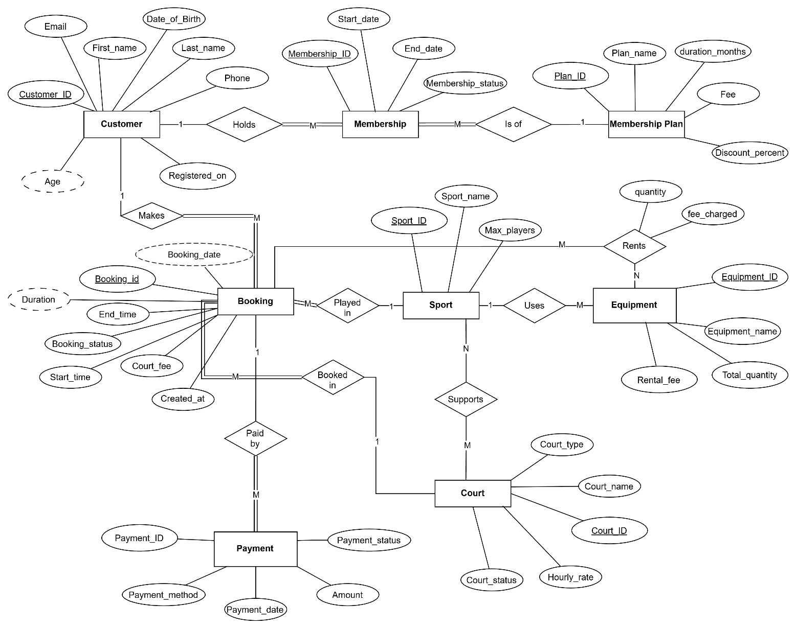

# Indoor Sports Facility Booking System

An Oracle database for an indoor sports centre. It stores customers, memberships, sports, courts, bookings, equipment rentals and payments. The database enforces the booking rules itself: it rejects double bookings, bookings on courts under maintenance and rentals beyond the stock on hand, and it calculates court and rental fees, including membership discounts.

Built for COMP 3610 (Database Systems) at Thompson Rivers University by Argo Dhali, Michael Ezeobidi, Fayokunmi Olowomakan and David Pelemo.

## Progress

- [x] Part 0: tools and repository
- [ ] Part 1: parent tables and drop script
- [ ] Part 2: child tables
- [ ] Part 3: indexes
- [ ] Part 4: row-level triggers (rules 2, 3, 4, 6)
- [ ] Part 5: compound triggers (rules 1, 5)
- [ ] Part 6: sample data
- [ ] Part 7: report views
- [ ] Part 8: break-it tests
- [ ] Part 9: one-step rebuild and finish

What each part builds and how to test it is in [ROADMAP.md](ROADMAP.md).

## Design



Ten tables, six trigger rules, seven indexes, six report views and a court availability query.

## How to run

Connect to an empty Oracle schema (12c or later) and run:

```
@install.sql
```

## Repository layout

```
install.sql   runs every script in sql/ in order
sql/          tables, indexes, triggers, sample data and views
tests/        test scripts; each one ends with ROLLBACK
queries/      queries that take inputs, such as court availability
docs/         ER diagram and recorded test results
```
